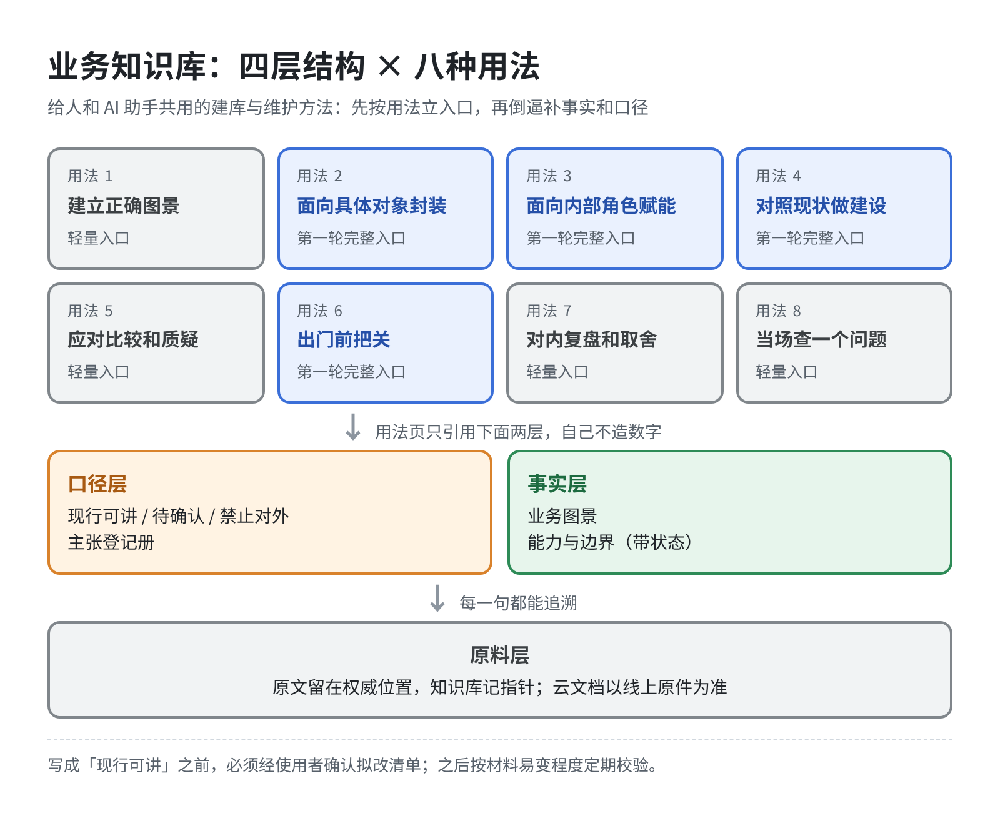
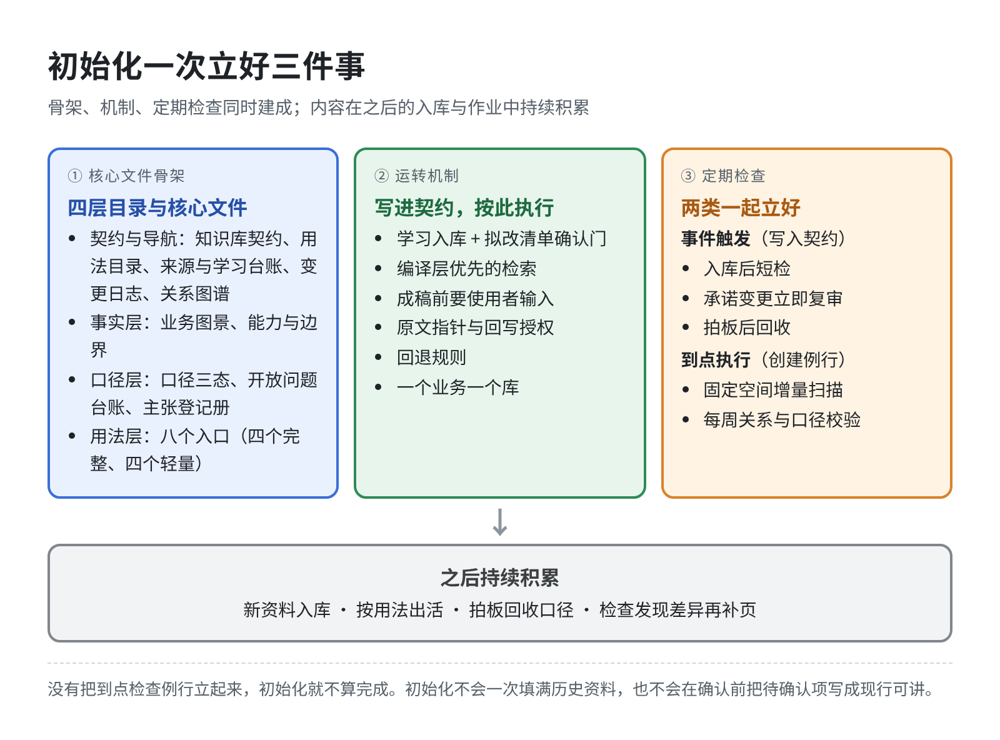
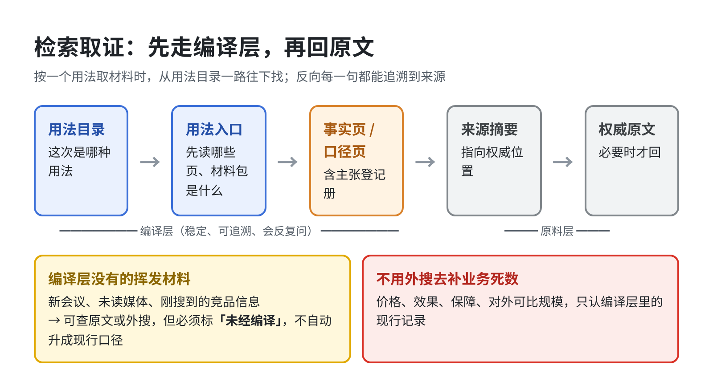
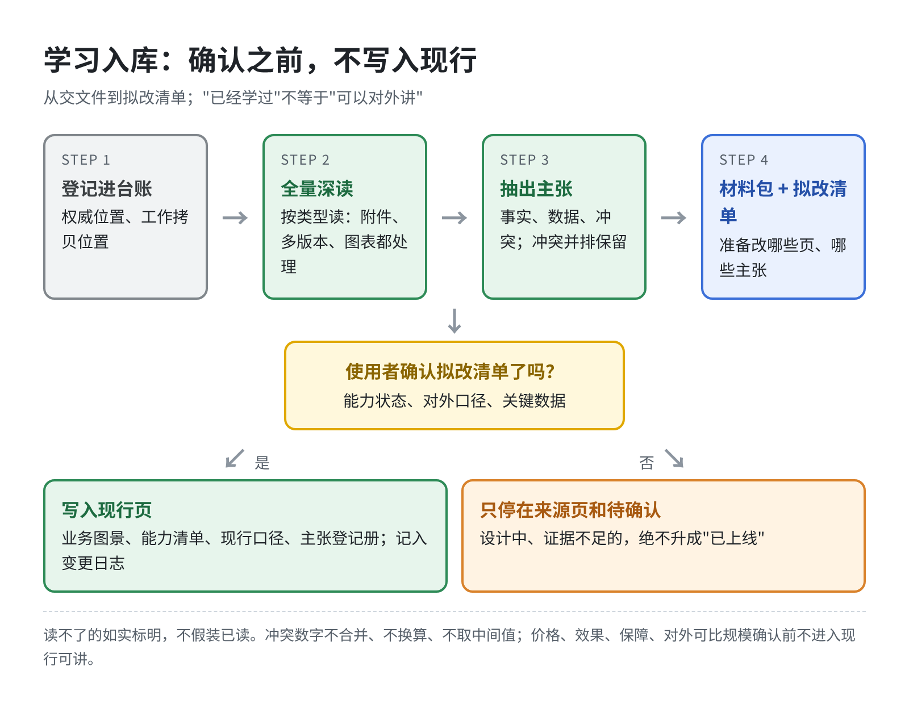

# 业务知识库方法（存档）

这是一套给人和 AI 助手共用的**业务知识库建设与维护方法**，用来解决一个常见问题：进入一个新业务时，材料很多、说法互相冲突，如果把培训稿、设计稿、一线口头承诺和现行能力堆在一起，用的时候很容易讲错。

本仓库存档的是**方法本身**，不是某个具体业务的机密材料。业务里的事实、价格、口径和客户信息，应放在该业务自己的知识库中，不放在本仓库。

整理时间：2026-11-13。完整操作说明见 [使用说明](docs/使用说明.md)：初始化要一次立好文件骨架、运转机制和定期检查例行，之后按说明日常使用。

## 这套方法是什么

核心做法是：你把一个业务的文件或云文档交给助手，助手按固定流水线学习、整理、供日常调用，并定期检查知识库有没有过时或讲错。

它约定了四件事：

1. **知识怎么分层**：原料、事实、口径、用法分成四层，不混在一个文件夹里。
2. **知识怎么被用**：先识别八种稳定用法，再按用法去取材料、加工和输出。
3. **知识怎么检索**：先走编译好的页面，必要时再回到原文或外部调研；加工成稿必须有使用者输入。
4. **知识怎么更新**：学习可以批量进行，但写成「现行可讲」之前必须经过确认；之后按材料的易变程度定期校验。

检索和编译的思路借鉴了 [Andrej Karpathy 的 LLM Wiki](https://gist.github.com/karpathy/442a6bf555914893e9891c11519de94f)：原文不动，先编译成可引用的页面，用目录和日志维护，定期体检。同时吸收了 [Diátaxis](https://www.diataxis.fr/)（按使用需求组织，不按资料类型组织）、销售内容治理中的主张登记与到期复审，以及「稳定知识走编译层、新材料走原文或外搜」的分层检索。明确不采用的做法是：用外网搜索去补业务死数，以及把所有文件复制进一个新中心、让副本冒充权威原文。

## 四层结构

| 层 | 回答的问题 | 要点 |
|---|---|---|
| 原料层 | 原文在哪、是谁在什么时间主张的 | 原文不改、不删、不合并。本地或云文档都以权威位置为准，知识库先记指针；需要识别、渲染或转写时，才做只读的工作拷贝。 |
| 事实层 | 这个业务现在是什么 | 能力必须标明状态：已上线、部分上线、设计中、证据不足。规划不能写成现状。 |
| 口径层 | 能讲什么、不能讲什么 | 现行可讲、待确认、禁止对外（可加仅对内）。每条对外主张单独登记，并保留证据、复审期和下游依赖。 |
| 用法层 | 这一次要完成哪类作业 | 按八种用法设入口。用法页只引用事实和口径，自己不另造数字。 |

必须写死的分界：培训稿不等于已上线；设计稿不等于可售卖能力；竞品库不等于对客话术；案例素材不等于证据；价格结构不等于可以报出的死价；内部系统不等于对外产品卖点。

## 八种用法

1. 建立正确图景  
2. 面向一个具体对象做封装（例如一个客户、一个行业）  
3. 面向内部角色做赋能  
4. 对照现状做建设和改进  
5. 应对比较和质疑  
6. 出门前把关  
7. 对内复盘和取舍  
8. 当场查一个具体问题  

大多数业务会先把第 2、3、4、6 种用法的入口建起来。用法决定知识库怎么建：先立作业入口，再倒逼补事实和口径，而不是先穷尽历史资料。

按用法取材料时，先走编译好的页面，再回原文：

## 使用者要做什么

使用者不用自己分类、写摘要或维护链接。初始化时说明：这是什么业务、权威资料在哪、口径由谁拍板、眼下主要用哪几种用法，然后把文件或云文档交给助手。

之后只需在这些节点出手：

- 确认拟改清单（能力状态、对外口径、关键数据）之后，助手才写入现行页  
- 出成稿前说明要出什么、给谁用、边界在哪  
- 拍板待确认项；回写权威稿时单独授权  

深读和整理由助手按技能执行。正文取不到、关键数字看不清又会影响口径，或缺少必要授权时，助手才会中断询问。

## 仓库里有什么

先读本页了解这套方法是什么，再读 [使用说明](docs/使用说明.md) 了解怎么初始化、怎么日常使用、怎么做定期检查；全部配图在 [docs/images/](docs/images/)。设计来源见 [方案说明](docs/方案说明.md)。

技能按「1+3」保存：一个主入口，三个按任务加载的配套技能。

| 技能 | 何时使用 | 文件 |
|---|---|---|
| 业务知识库 | 进入新业务建库、交来一批资料、询问知识库怎么用，或不确定下一步时。先加载它。 | [skills/业务知识库/SKILL.md](skills/业务知识库/SKILL.md) |
| 业务知识库-学习入库 | 登记、全量深读、处理图片和表格、抽出数据主张，并产出拟改清单。写入现行前必须确认。 | [skills/业务知识库-学习入库/SKILL.md](skills/业务知识库-学习入库/SKILL.md) |
| 业务知识库-用法检索 | 已有知识库之后，按某一种用法取材料、封装方案、赋能、建设、竞品调研、把关或当场查询。 | [skills/业务知识库-用法检索/SKILL.md](skills/业务知识库-用法检索/SKILL.md) |
| 业务知识库-定期校验 | 例行检查是否过时或讲错、扫描增量、拍板后回收口径，以及体检断链或「未读却标已读」。 | [skills/业务知识库-定期校验/SKILL.md](skills/业务知识库-定期校验/SKILL.md) |

技能是通用模板，换一个业务也可以用。不要把某个业务的内部数字、客户信息或未公开口径写进这些文件。

## 学习与原文

- 交给助手的资料默认全部深读，附件、多版本、图表都要处理；读不了的如实标明，不假装已读。  
- 云文档以线上原件为准；学习时抓取当时正文作为工作拷贝，页面更新后再取新版对照，不用过期副本冒充最新稿。  
- 读文档时可按效果选择工具（文本抽取、渲染加识别、表格读取、音视频转写），不锁死某一个插件。工具只负责把正文、图和数取出来；是否写成现行口径，仍按确认规则执行。  
- 关键数据单独登记，冲突并排保留，不合并、不换算。涉及价格、效果、保障和对外可比规模的，确认前不进入现行可讲。不用外网搜索去补这些业务死数。竞品情况和策略调研可以外搜，但新信息先当证据，不自动写成现行口径。

## 许可与使用

本仓库作为方法存档，供仓库所有者及其助手使用。若对外公开，请先确认其中没有误放具体业务的内部信息。
