# 业务知识库使用说明

本文是给人看的完整使用说明：初始化要建立什么、之后怎么用、定期检查怎么转，以及本仓库建议配哪些图。方法细节以 `skills/` 中四个技能正文为准。整理于 2026-11-13。

本仓库只存方法，不存某个业务的机密材料。

## 两个关键问题

**初始化会不会把后续定期检查也创建好？应该创建好，而且这是初始化的必做项，不是建完库之后再另想的事。** 检查分成两类：一类是事件触发的（你交来新资料后的短检、价格或承诺变更后的立即复审、你拍板后的回收），初始化时要把规则写入该业务的 `知识库契约` 和变更日志，之后自动执行，不必再单独建一条日程。另一类是到点就要跑的（固定资料空间的增量扫描、每周关系与口径校验、定期体检），初始化时必须问清固定资料空间和希望的检查日，并创建对应例行。若该业务已经有同类例行，就对齐并补缺，不要另起一套互相打架的台账。

此前技能把检查方法写清楚了，但「第一轮最小闭环」只列了核心文件，没有把创建定期检查例行写成必做步骤。这一点已经补进本说明和主技能：初始化没有把到点检查立起来，就不能算初始化完成。

**初始化会不会把整套方案的流程和机制都建立好？会把骨架和机制全部立起来，但不会一次把内容填满。** 建好的是：四层目录和核心文件、学习入库流水线、检索与加工门禁、使用者确认和拍板节点、原文指针与回写规则、回退规则，以及上一问里的定期检查。第一轮要交出最小闭环文件，并把四种主用法入口先建起来。不会在初始化当天穷尽历史资料，也不会在你确认之前把待确认项写成现行可讲。之后每次交文件、每次按用法作业，都是在这套已经立好的机制上积累，而不是每次重做一套。

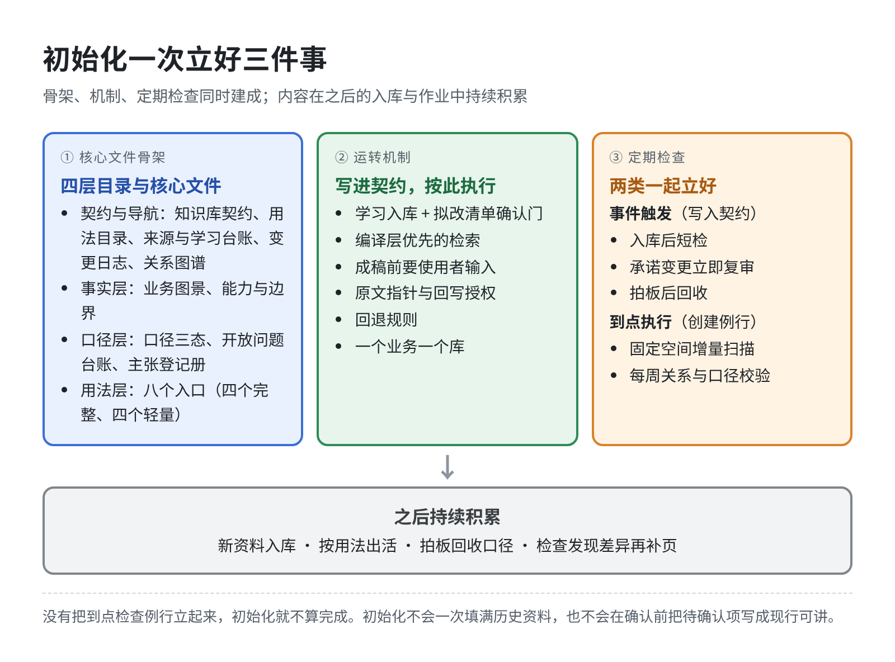

图的文字版（Mermaid 源）

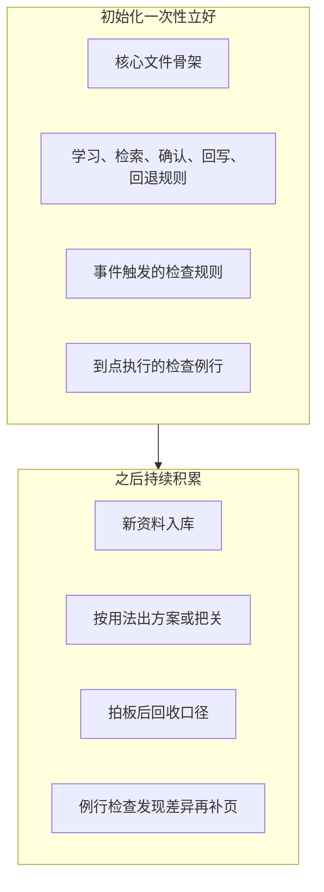

## 初始化要一次性建立的三件事

### 1. 核心文件骨架

契约和导航：`知识库契约`、`用法目录`、`来源与学习台账`、`变更日志`、`关系图谱`。

事实层：`业务图景`、`能力与边界`；并预留 `客户与市场`、`成交与履约`、`内部系统`、`经营节奏` 的位置，有材料再补正文。

口径层：`口径三态`、`开放问题台账`、`主张登记册`。

用法层：八个用法入口都要建出来。其中封装、赋能、建设、把关四个写成完整入口（先读哪些页、材料包是什么、哪一步等你输入、出门前自查哪几条）；其余四个先做轻量入口和检索路径。

四层不要混在一个文件夹里：

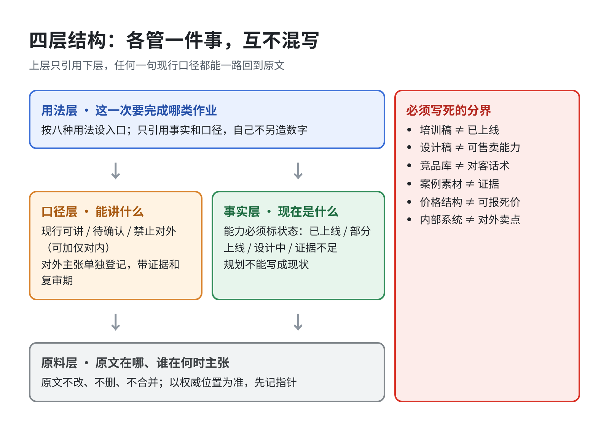

图的文字版（Mermaid 源）

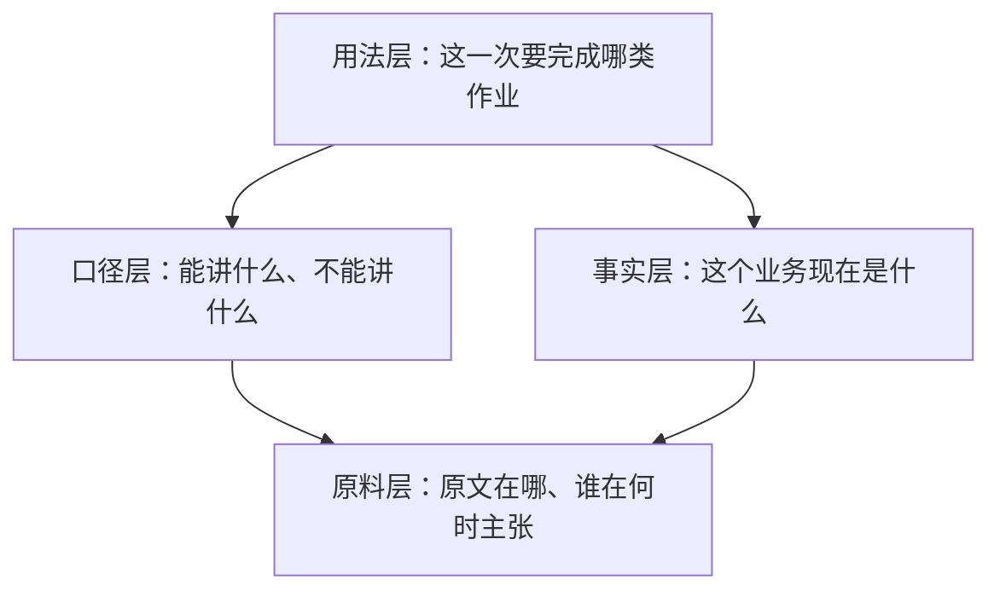

### 2. 运转机制

这些不是「以后再商量」，初始化时就要写进该业务的契约，并按此执行：

- 学习流水线：登记 → 全量深读 → 抽出主张 → 材料包和拟改清单 → 你确认后才写入现行页
- 检索：先走编译页；未编译材料可查原文或外搜，但必须标明「未经编译」，不得自动升成现行口径
- 加工成稿前，必须有你对输出形态、对象和限制的输入
- 原文留在权威位置，知识库先记指针；云文档以线上原件为准（见下图）
- 权威稿回写必须单独授权；写错了只回退现行页，不改原文
- 一个业务一个库，互不混写

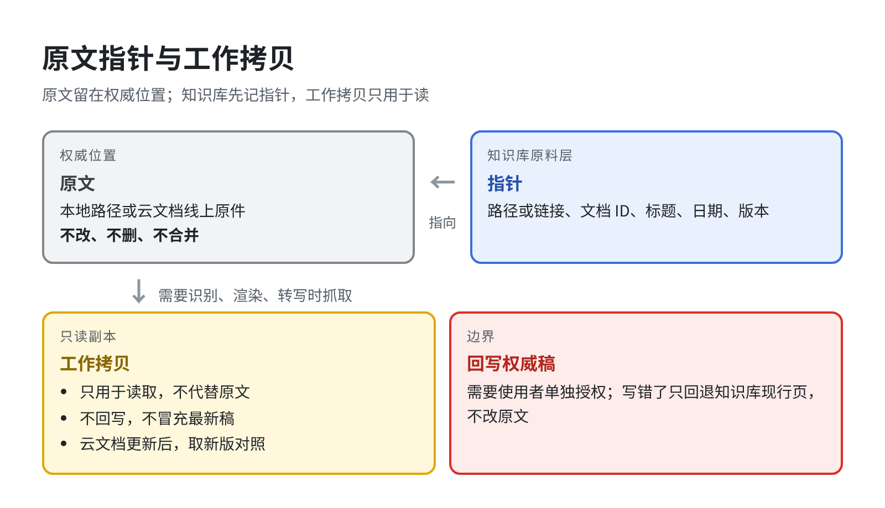

### 3. 定期检查

初始化结束前，要同时落实下面这张表。

| 检查 | 触发方式 | 初始化时做什么 |
|---|---|---|
| 入库后短检 | 你交来新资料并完成学习时自动做 | 把规则写入契约，不必建日程 |
| 价格或对外承诺变更后的立即复审 | 新材料改到了这类主张时自动做 | 把规则写入契约，并核对该主张的下游依赖 |
| 拍板后回收 | 你完成拍板后自动做 | 把规则写入契约：待确认改为现行或禁止，同步改相关页 |
| 固定资料空间的增量扫描 | 按约定周期到点执行 | 问清空间位置和周期，创建例行；没有新材料就记「无增量」 |
| 每周关系与口径校验 | 每周到点执行 | 问清检查日，创建例行；无实质变化不打扰你 |
| 定期体检（断链、未读却标已读、双台账等） | 可并入每周校验，或另定更长周期 | 写进入口和例行，不要遗漏 |

事件触发的检查和到点执行的检查要一起立好：

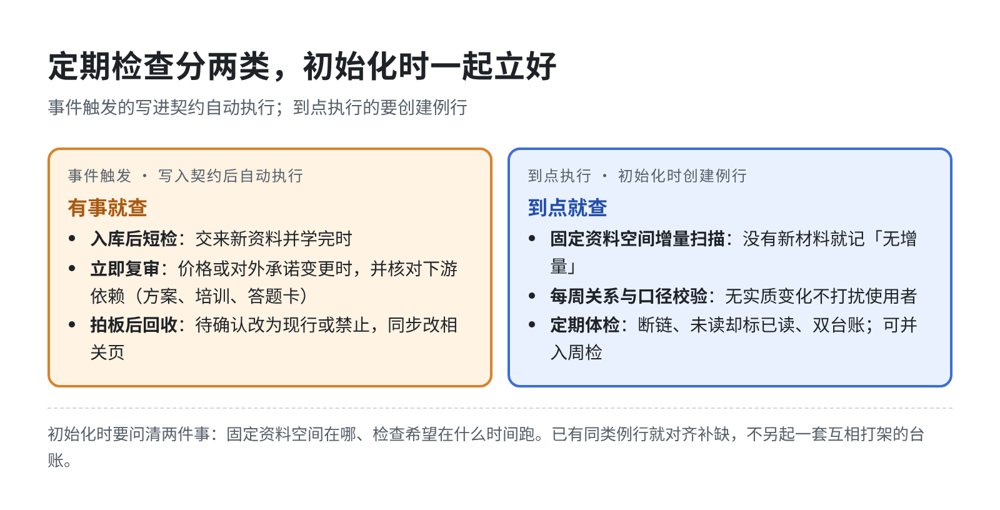

图的文字版（Mermaid 源）

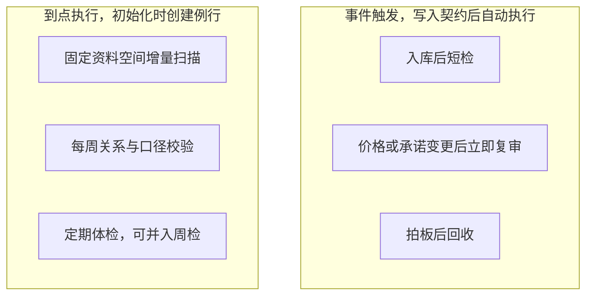

初始化还要向你确认四件边界，外加两件检查相关的事：这个业务是什么、权威资料在哪、口径由谁拍板、眼下主要用哪几种用法；以及固定资料空间在哪、检查希望在什么时间跑。然后你把现有文件交来。

## 日常怎么用

### 你交来一批新文件或云文档

助手走学习入库，不停留在目录盘点。你收到的是材料包加拟改清单。你确认会改能力状态、对外口径或关键数据的部分之后，这些才进入现行页；未确认的停在来源页和待确认。读不了的会如实标明。

### 你要按某种用法出活

先说明这次要出什么、给谁用、有什么限制。助手从用法目录进入对应入口，先取编译页，必要时再回原文或做竞品外搜。你先看到材料包，再决定成稿形态。出门前走把关清单。

八种用法是：建立图景；面向具体对象封装；内部赋能；对照现状做建设；应对比较和质疑；出门前把关；对内复盘取舍；当场查询。具体策略见 [用法检索技能](../skills/业务知识库-用法检索/SKILL.md)。

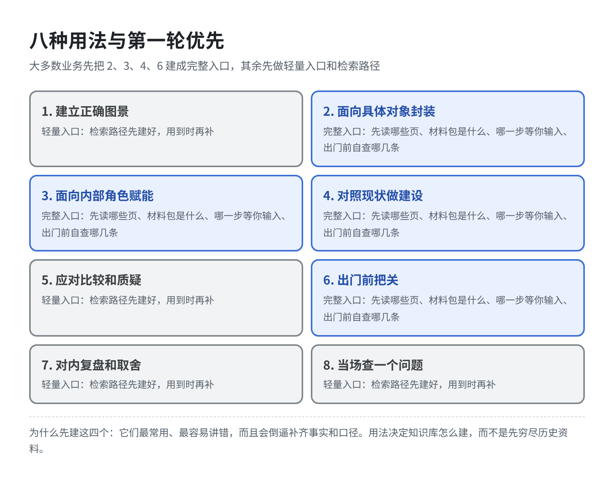

### 你拍板待确认项

拍完后助手回收到主张登记册和相关页面。需要改权威原稿时会单独问你，没有授权不动。

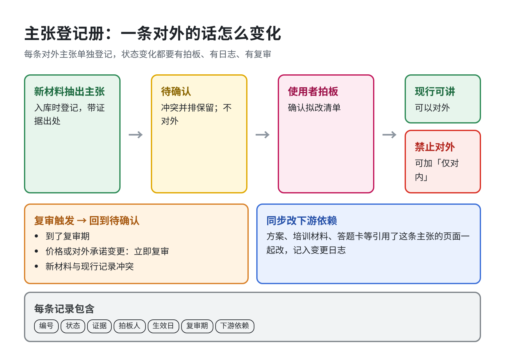

### 到了检查日

助手按例行跑增量扫描或每周校验。有实质变化才给你简报，并列出待拍板项；没有变化不会打扰你。

### 你要做的，和不用做的

你要做的是：初始化时定边界并交文件；日常丢新资料，并说明本次产出形态；确认拟改清单；拍板待确认项；回写权威稿时授权。

你不用做的是：自己分类、写摘要、维护链接、运行每周校验，以及在聊天里反复指出该去哪找资料。

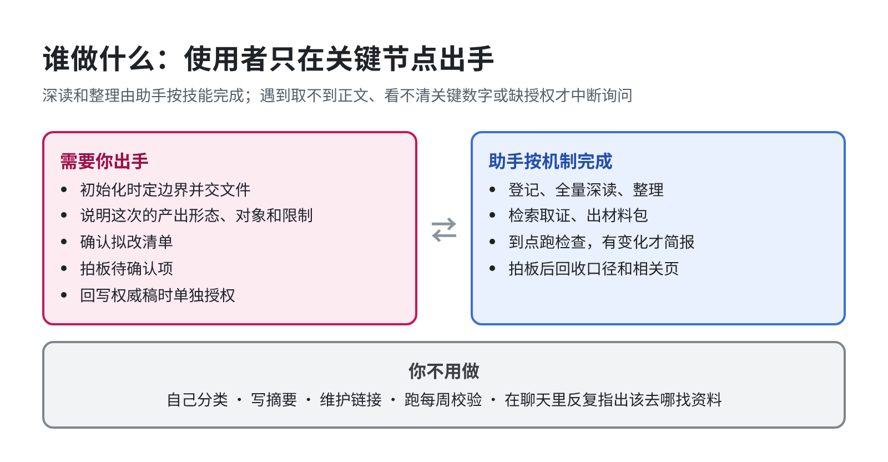

图的文字版（Mermaid 源）

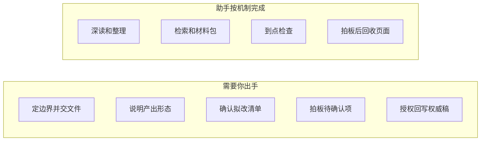

## 学习、检索和检查怎么转

学习入库：

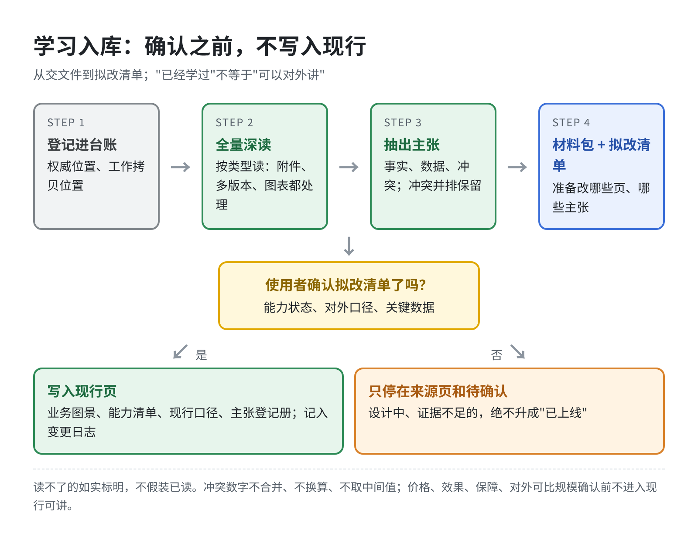

图的文字版（Mermaid 源）

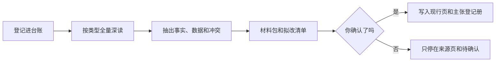

检索取证：

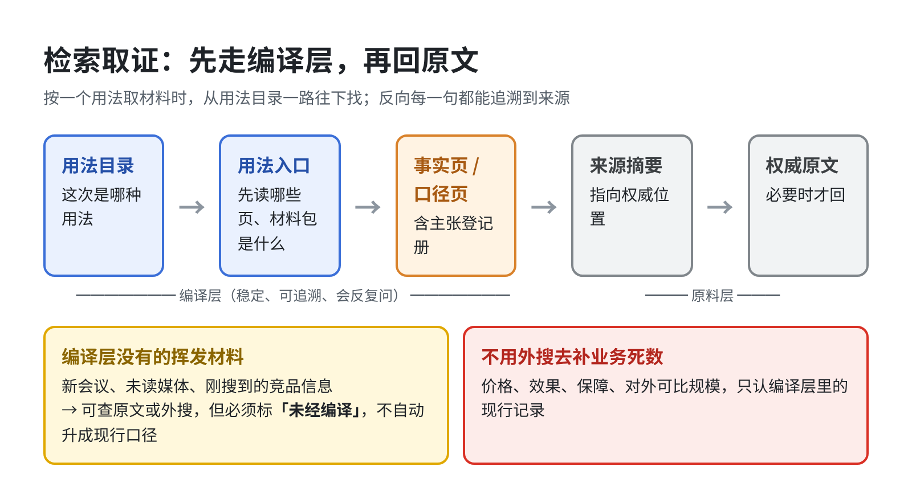

图的文字版（Mermaid 源）

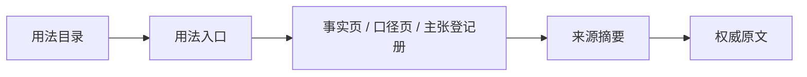

尚未编译的新会议、未读媒体、刚搜到的竞品信息，可以走原文或外搜，但必须标「未经编译」。价格、效果、保障、对外可比规模等业务死数，不能用外网搜索去补。

## 建议配哪些关键图

仓库说明主要靠文字和下面这些图把机制看清。图是为了把关系一次讲明白，不是装饰。下面九张已导出为独立配图，放在 [`docs/images/`](images/)，并已插到本说明对应的章节旁；README 首页另有一张总览图 `00-总览-四层结构与八种用法.png`。

| 优先级 | 图 | 它要讲清楚的事 | 为什么关键 |
|---|---|---|---|
| 必配 | 初始化立起的三件事（`01`） | 文件骨架、运转机制、定期检查例行是一次建成的 | 直接回答「初始化有没有把流程和检查也立好」 |
| 必配 | 四层结构（`02`） | 原料、事实、口径、用法各管什么，互不混写 | 这是整套方法的底图，几乎所有后续说明都指回它 |
| 必配 | 学习入库流水线（`03`） | 从交文件到拟改清单，确认前不写入现行 | 防止把「已经学过」理解成「已经可以对外讲」 |
| 必配 | 检索取证路径（`04`） | 从用法目录一路回到原文，以及未经编译材料怎么标 | 解决「按一个用法时该找哪些资料」 |
| 必配 | 使用者出手节点（`05`） | 哪些事必须你做，哪些事助手按机制做完 | 避免初始化时误以为要自己维护库 |
| 必配 | 定期检查分层（`06`） | 哪些是事件触发，哪些是到点例行 | 避免只建了文件、没有检查日程 |

这六张已经够把使用说明讲完整。下面三张是加分项，也已一并导出：

| 优先级 | 图 | 它要讲清楚的事 | 何时需要 |
|---|---|---|---|
| 选配 | 八种用法与第一轮优先（`07`） | 八个入口，以及为什么先建封装、赋能、建设、把关 | 给人快速看用法全貌时 |
| 选配 | 主张登记册生命周期（`08`） | 一条对外的话如何从待确认变为现行或禁止，以及复审和下游依赖 | 讲口径治理、到期复审时 |
| 选配 | 原文指针与工作拷贝（`09`） | 权威位置仍在原处，副本只用于识别或转写 | 讲云文档或原文存放时 |

不建议做成配图的：具体业务的能力清单、价盘、客户案例、内部系统截图。那些属于业务知识库正文，不应放进本方法仓库。也不需要为每一种文件读法（PDF、PPT、表格）各画一张操作图，读法写成文字标准即可，工具在执行时按效果选择。

配图风格建议：一图只讲一件事，用中文短标签，少装饰；结构图用层级或矩阵，流程用从左到右的步骤，检查用「事件触发 / 到点执行」对照。不要把四层、八种用法、流水线和检查日程画进同一张大图。

## 仓库里怎么读

1. 先读本仓库根目录 [README](../README.md)，了解这套方法是什么。
2. 再读本文，按初始化、日常使用和检查来用。
3. 执行时按任务打开技能：[业务知识库](../skills/业务知识库/SKILL.md) 是总入口，配套是 [学习入库](../skills/业务知识库-学习入库/SKILL.md)、[用法检索](../skills/业务知识库-用法检索/SKILL.md)、[定期校验](../skills/业务知识库-定期校验/SKILL.md)。
4. 设计来源和借鉴见 [方案说明](方案说明.md)。
